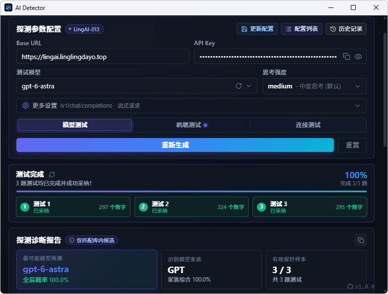
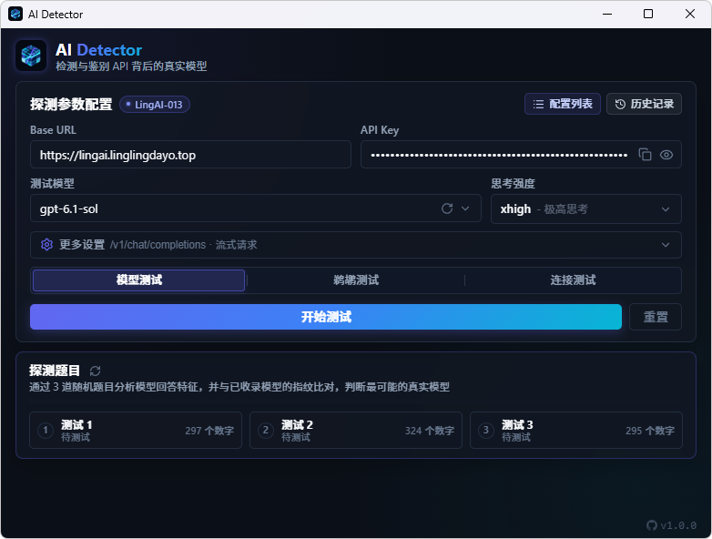
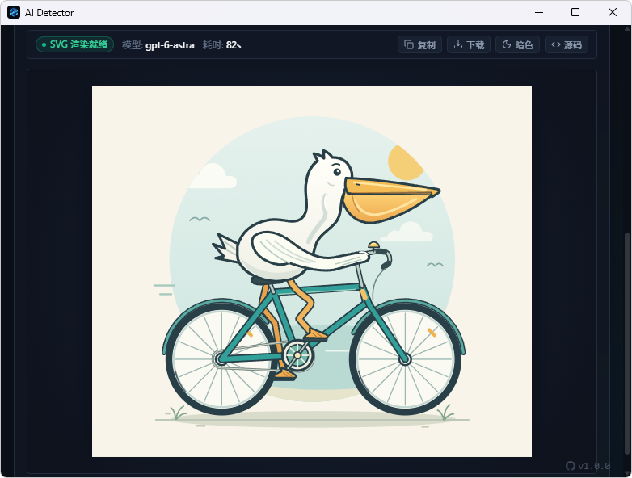
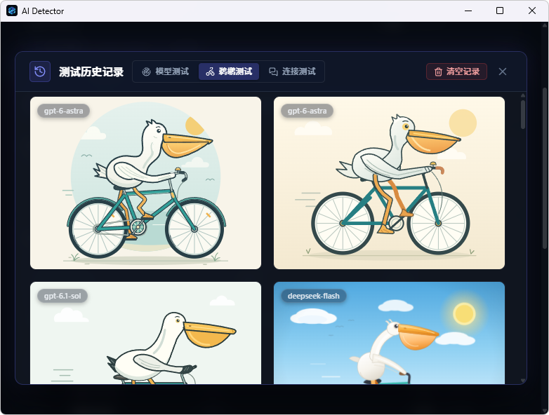
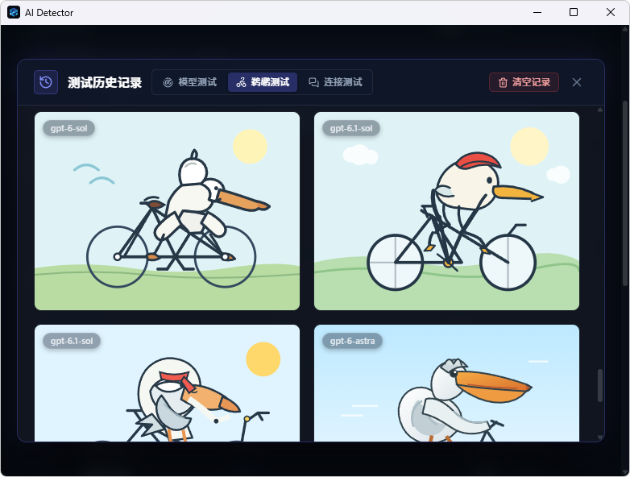

# AI 模型检测器 (AI Detector)

<p align="center">
  <strong>基于 Tauri 与 Vue 3 的轻量级大语言模型指纹探测与真实性检测桌面客户端</strong>
</p>

<p align="center">
  
  
  
  
  
</p>

---

## 📖 项目简介

**AI 模型检测器 (AI Detector)** 是一款专为大语言模型（LLM）API 设计的真实性验证桌面客户端。

随着各类大模型 API 中转服务与聚合平台的普及，市场上存在部分服务商为了降低成本，对模型进行“掺水”、“降级”甚至“货不对板”的伪造行为。本项目提供**模型探针测试**、**鹈鹕视觉测试**、**糖果逻辑测试**与**连接测试**四维互补的检测方式，帮助开发者与用户快速识破虚标模型。

<p align="center">
  
</p>

---

## 🧪 四大测试模式

本项目内置四大不同维度的测试能力，兼顾**统计指纹比对**、**直观视觉代码**、**长逻辑链推理**与**真实链路诊断**：

### 1. 🔬 模型测试（探针指纹比对）
- **检测原理**：向目标 API 随机发送 3 道精心构造的测试挑战题，采集模型输出的统计学行为指纹，通过 Hellinger 距离与多维特征频数算法与基准模型库比对。
- **适用场景**：精准识别目标 API 背后真实的模型家族与具体版本。
- **数据支撑**：基于开源项目 ModelTrace 的统一模型题库，支持一键在线同步更新。

### 2. 🚴 鹈鹕测试（SVG 空间视觉检验）
- **检测原理**：请求模型编写“骑自行车的鹈鹕”或“动态丹顶鹤”等纯矢量图形代码。
- **适用场景**：直观检验模型的空间几何构图、坐标系理解与高质量结构化代码能力。顶级模型能呈现出具象协调的画面，而降级模型生成的图形通常严重形变或无法闭合。
- **交互体验**：内置沙箱级安全隔离预览、流式生成进度与耗时感知，并支持测试结果画廊归档。

### 3. 🍬 糖果测试（长逻辑链与推理检验）
- **检测原理**：动态生成包含多步转移与多重约束的糖果分配逻辑题，由后端引擎精确判定，全自动评估模型在长链逻辑计算中的准确率与响应表现。
- **适用场景**：快速甄别模型是否存在“掺水降智”或混用参数缩水的小模型。弱模型在面对严苛的多步数学逻辑推导时极易暴露幻觉与逻辑断层。
- **交互体验**：自动化批量出题与评测追踪，直观展示每道题目的解答过程、标答比对与整体通过率。

### 4. 💬 连接测试（自由对话与链路诊断）
- **检测原理**：支持自由多轮对话与单轮快速测活，实时比对请求模型标识与响应头路由，采集全链路性能表现。
- **适用场景**：验证接口真实可用性、流式响应稳定性、真实模型路由一致性以及上下文承载能力。
- **交互体验**：提供完整对话与精简测活双视图，实时呈现首字延迟、输出吞吐（Tokens/s）、缓存读写及用量统计。

---

## ✨ 核心特性

- **四维检测体系**：融合统计指纹、SVG 视觉生成、复杂逻辑推理与链路连通性，全方位立体交叉验证。
- **轻量原生跨平台**：基于 Tauri v2 (Rust) 构建，原生 WebView 渲染，毫秒级快速启动，极低系统资源占用。
- **真实链路与路由核对**：实时核验多轮会话真实响应模型路由，全面统计首字耗时、流式速率与 Token 缓存命中。
- **通用设置与个性化体验**：支持明暗双主题无缝切换，提供独立的流式/非流式超时配置、重试策略与记录归档上限调节。
- **多配置管理与保护机制**：支持多套 API 端点管理与拖拽排序，测试运行过程中具备误触保护与状态提示。
- **主流模型思考强度适配**：原生兼容 Gemini、Kimi、GLM 等主流模型推理强度的动态调节与按需映射。
- **集中历史归档管理**：所有测试模块结果独立归档管理，支持结果安全隔离预览、详情复盘与单条清理。
- **上游题库一键在线同步**：内置自动化更新脚本，随时同步上游 ModelTrace 指纹题库最新数据。

---

## 🖼️ 界面预览

<details>
<summary>展开查看更多界面截图</summary>

<br />

| 模型测试配置 | 鹈鹕测试结果 |
| :---: | :---: |
|  |  |

| 鹈鹕历史记录 | 鹈鹕历史记录（降智时） |
| :---: | :---: |
|  |  |

</details>

---

## 🤝 鸣谢 (Acknowledgements)

本项目的模型探针题库与指纹算法来源于开源项目 **[ModelTrace](https://github.com/xqy2006/ModelTrace)**（作者：[@xqy2006](https://github.com/xqy2006)）。本项目在其研究成果与数据基础上构建了跨平台桌面端应用，在此向原作者的开源贡献致以诚挚感谢！

---

## 🛠️ 技术栈

- **桌面运行时**：[Tauri v2](https://v2.tauri.app/) (Rust)
- **前端框架**：[Vue 3](https://vuejs.org/) (Composition API, `<script setup>`)
- **状态管理**：[Pinia](https://pinia.vuejs.org/)
- **语言**：[TypeScript](https://www.typescriptlang.org/)
- **构建工具**：[Vite](https://vitejs.dev/) + [Sass](https://sass-lang.com/)
- **测试框架**：[Vitest](https://vitest.dev/)

---

## 🚀 快速上手

### 环境准备

- [Node.js](https://nodejs.org/) (推荐 18.0 或更高版本)
- [Rust 环境](https://www.rust-lang.org/tools/install) (仅在本地编译 Tauri 原生桌面端时需要)

### 安装依赖

```bash
npm install
```

### 启动开发环境

```bash
# 启动前端 Web 界面开发预览
npm run dev

# 启动完整 Tauri 桌面端开发环境（需配置 Rust 环境）
npm run tauri dev
```

### 同步最新指纹题库

本项目内置了题库同步脚本，可直接拉取上游 `ModelTrace` 仓库发布的最新数据：

```bash
# 检查上游题库是否有更新
npm run sync:check

# 同步并覆盖本地数据题库
npm run sync
```

### 运行测试

```bash
# 运行全部单元测试
npm test
```

### 构建打包

```bash
# 构建前端生产资源
npm run build

# 构建桌面端安装包 (输出至 src-tauri/target/release/bundle)
npm run build:app

# 单独将产物归档至 release/ 目录
npm run release:copy
```

---

## ⚠️ 免责声明

1. 本工具的检测结果基于统计学概率与行为特征指纹比对，结果仅供技术研究、测试与参考。
2. 模型的采样参数（如 Temperature、Top-P、Reasoning Effort 思考强度等）以及服务商自定义的前置系统提示词（System Prompt）可能会对输出特征造成一定程度的扰动。

---

## 📄 开源许可证

本项目遵循 [MIT License](LICENSE) 开源协议。
同时请尊重并遵守上游项目 [ModelTrace](https://github.com/xqy2006/ModelTrace) 的开源使用规范与知识产权声明。
