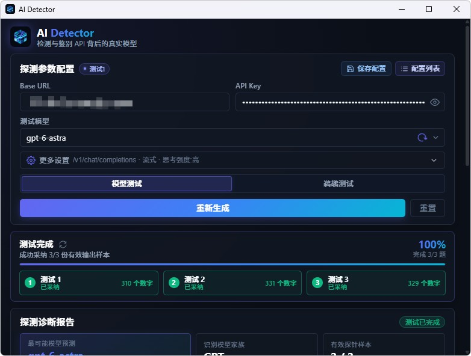

# AI 模型检测器 (AI Detector)

<p align="center">
  <strong>基于 Tauri 与 Vue 3 的轻量级大语言模型指纹探测与真实性检测桌面客户端</strong>
</p>

<p align="center">
  
  
  
  
  
</p>

---

## 📖 项目简介

**AI 模型检测器 (AI Detector)** 是一款专为大语言模型（LLM）API 设计的真实性验证桌面客户端。

随着各类大模型 API 中转服务与聚合平台的普及，市场上存在部分服务商为了降低成本，对模型进行“掺水”、“降级”甚至“货不对板”的伪造行为。本项目提供**模型探针测试**与**鹈鹕视觉测试**两种互补的检测方式，帮助开发者与用户快速识破虚标模型。

<p align="center">
  
</p>

---

## 🧪 双重测试模式 (Testing Modes)

本项目内置两种不同维度的测试方式，兼顾**统计学指纹归因**与**直观能力检验**：

### 1. 🔬 模型测试（探针指纹比对）
- **检测原理**：向目标 API 随机发送 3 道精心构造的测试挑战题，采集模型输出的统计学行为指纹，通过 Hellinger 距离与多维特征频数算法与基准模型库比对。
- **适用场景**：识别目标 API 背后真实的模型家族与具体版本。
- **数据支撑**：基于开源项目 ModelTrace 的统一模型题库，支持一键在线同步更新。

### 2. 🚴 鹈鹕测试
- **检测原理**：请求模型生成“骑自行车的鹈鹕”纯 SVG 矢量图代码。
- **适用场景**：直观检验模型是否存在“降智”或混用小模型。高质量大模型具备极强的空间几何构图与严谨的 SVG 代码能力，而低质或过度降级模型生成的画面往往严重扭曲、肢体错乱或无法闭合。
- **交互体验**：客户端内置 SVG / HTML 实时渲染预览、响应耗时统计，并支持自定义测试提示词。

---

## ✨ 核心特性

- 🧪 **双重检测体系**：结合 ModelTrace 探针指纹算法与鹈鹕 SVG 视觉测试，多维度交叉验证。
- ⚡ **轻量跨平台**：基于 Tauri v2 构建，原生系统 WebView 渲染，内存占用极低，毫秒级快速启动。
- 🎛️ **多配置管理**：支持保存、更新、快速切换多套 API 端点（Base URL、API Key、模型名称、思考强度等）。
- 📊 **可视化诊断**：实时展示测试流式状态、详细挑战日志以及 Top 匹配候选模型排名与置信度。
- 🔄 **上游题库一键同步**：内置自动化更新脚本，随时与上游指纹库保持最新同步。

---

## 🤝 鸣谢 (Acknowledgements)

本项目的模型探针题库与指纹算法来源于开源项目 **[ModelTrace](https://github.com/xqy2006/ModelTrace)**（作者：[@xqy2006](https://github.com/xqy2006)）。本项目在其研究成果与数据基础上构建了跨平台桌面端应用，在此向原作者的开源贡献致以诚挚感谢！

---

## 🛠️ 技术栈

- **桌面运行时**：[Tauri v2](https://v2.tauri.app/) (Rust)
- **前端框架**：[Vue 3](https://vuejs.org/) (Composition API, `<script setup>`)
- **语言**：[TypeScript](https://www.typescriptlang.org/)
- **构建工具**：[Vite](https://vitejs.dev/) + [Sass](https://sass-lang.com/)

---

## 🚀 快速上手

### 环境准备

- [Node.js](https://nodejs.org/) (推荐 18.0 或更高版本)
- [Rust 环境](https://www.rust-lang.org/tools/install) (仅在本地编译 Tauri 原生桌面端时需要)

### 安装依赖

```bash
npm install
```

### 启动开发环境

```bash
# 启动前端 Web 界面开发预览
npm run dev

# 启动完整 Tauri 桌面端开发环境（需配置 Rust 环境）
npm run tauri dev
```

### 同步最新指纹题库

本项目内置了题库同步脚本，可直接拉取上游 `ModelTrace` 仓库发布的最新数据：

```bash
# 检查上游题库是否有更新
npm run sync:check

# 同步并覆盖本地数据题库
npm run sync
```

### 构建打包

```bash
# 构建前端生产资源
npm run build

# 构建桌面端安装包 (输出至 src-tauri/target/release/bundle)
npm run build:app
```

---

## ⚠️ 免责声明

1. 本工具的检测结果基于统计学概率与行为特征指纹比对，结果仅供技术研究、测试与参考。
2. 模型的采样参数（如 Temperature、Top-P、Reasoning Effort 思考强度等）以及服务商自定义的前置系统提示词（System Prompt）可能会对输出特征造成一定程度的扰动。

---

## 📄 开源许可证

本项目遵循 [MIT License](LICENSE) 开源协议。
同时请尊重并遵守上游项目 [ModelTrace](https://github.com/xqy2006/ModelTrace) 的开源使用规范与知识产权声明。
